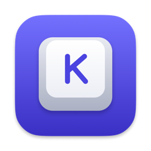
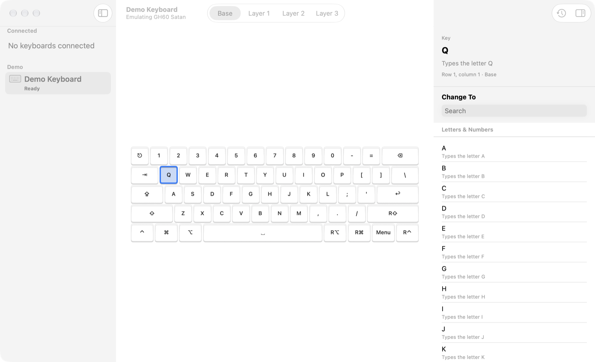
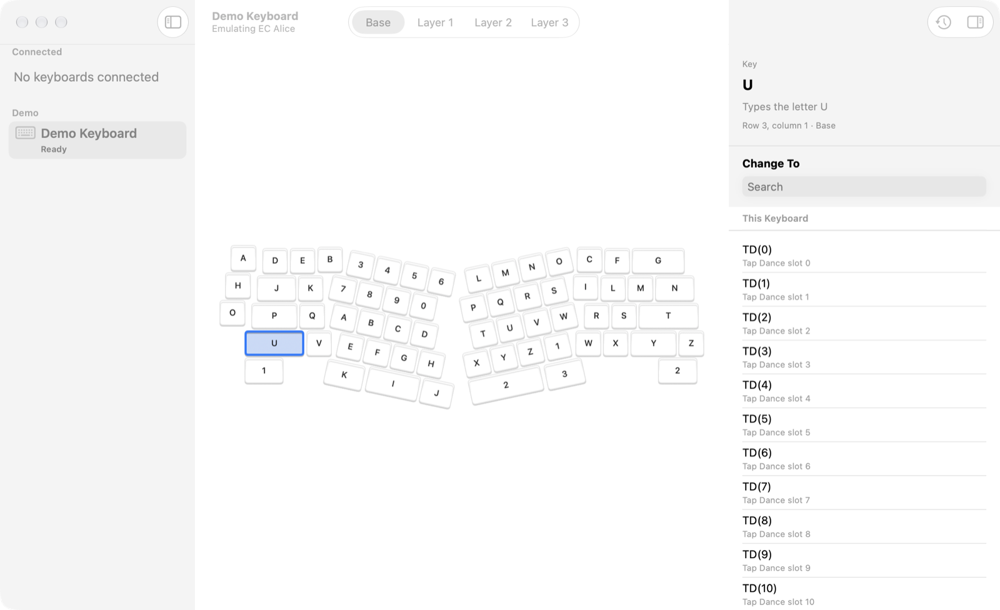
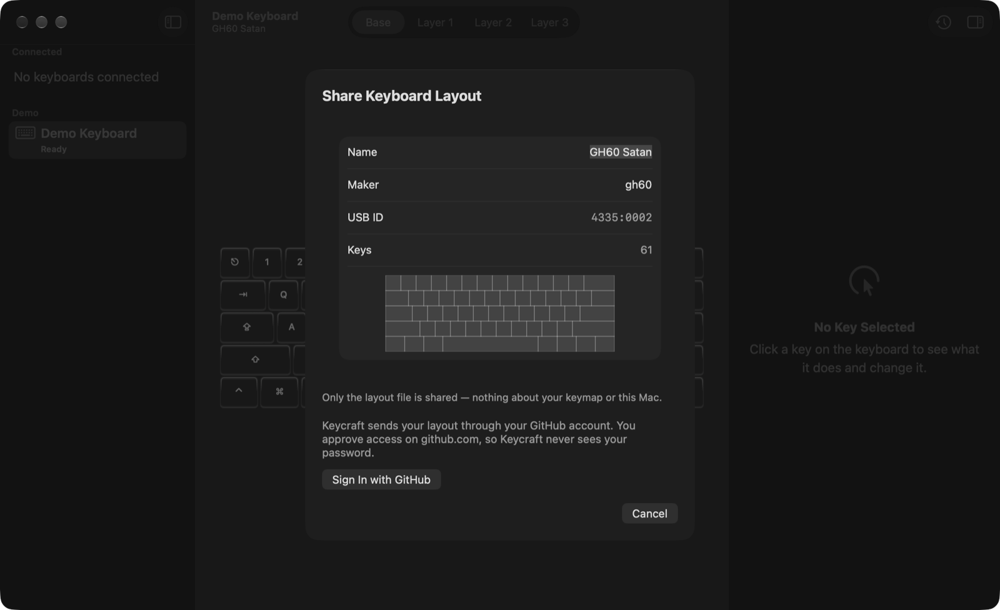
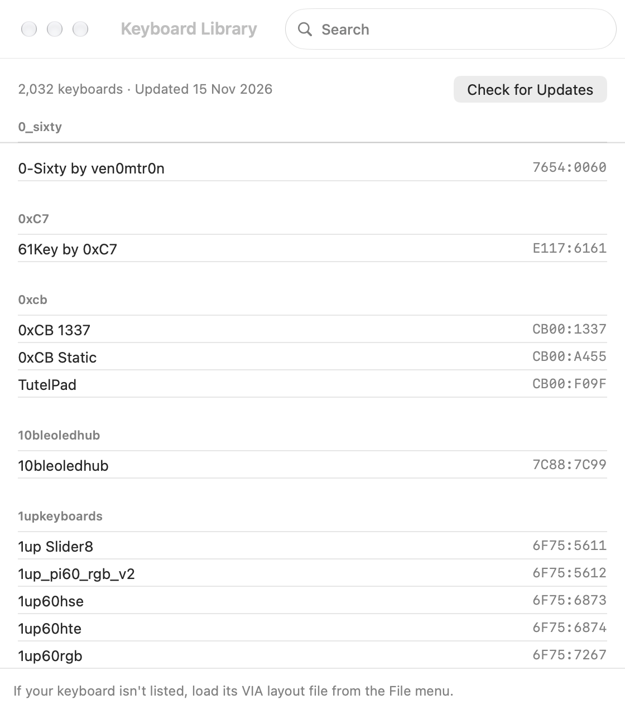

<p align="center">
  
</p>

<h1 align="center">Keycraft</h1>

<p align="center">
  Remap your mechanical keyboard from a real Mac app.<br>
  No browser, no drivers, no account.
</p>

<p align="center">
  <a href="https://github.com/shivvaaxx/keycraft/releases/latest/download/Keycraft.dmg"></a>
</p>

<p align="center">
  
  
  
  <a href="LICENSE"></a>
  <a href="https://ko-fi.com/shivvaaxx"></a>
</p>

<picture>
  <source media="(prefers-color-scheme: dark)" srcset="docs/images/hero-dark.png">
  
</picture>

## Why Keycraft

Web configurators work, but only in some browsers, only while a tab is open, and only when the browser
decides to see your keyboard. Keycraft is a native Mac app: plug the keyboard in and it's there.
Click a key, choose what it should do, and the change is on the keyboard a moment later.

## Features

- **Live remapping.** Changes are written straight to the keyboard and checked by reading them back.
- **Backs up first.** Before any change, Keycraft saves your current keymap and macros, and tells you
  plainly if something can't be backed up before you decide to go ahead. Restore any backup in one click.
- **2,000+ keyboards built in.** Layouts from the VIA community, kept up to date from
  [keycraft-keyboards](https://github.com/shivvaaxx/keycraft-keyboards) without app updates.
- **Any shape.** ISO and ANSI, splits, ergo and rotated thumb clusters are drawn exactly as they sit on your desk.
- **Every key explained.** Each option says what it does, in plain words, before you pick it.
- **Share new keyboards.** Keyboard not listed? Load its layout file, sign in with GitHub, and Keycraft
  opens a pull request so everyone gets it.
- **Feels like a Mac app.** Light and dark mode, full keyboard control, VoiceOver, and every command in the menu bar.
- **Try it without a keyboard.** A built-in Demo Keyboard can stand in for any keyboard in the library.

<table>
  <tr>
    <td width="50%"></td>
    <td width="50%"></td>
  </tr>
  <tr>
    <td align="center"><sub>Splits and rotated clusters, drawn true to life</sub></td>
    <td align="center"><sub>Share a new layout with one pull request</sub></td>
  </tr>
</table>

## Install

Download **[Keycraft.dmg](https://github.com/shivvaaxx/keycraft/releases/latest/download/Keycraft.dmg)**,
open it, and drag Keycraft to Applications. It's signed and notarized by Apple, so it opens like any other app.

Requires macOS 14 Sonoma or later, on Apple silicon or Intel.

## Supported keyboards



Keycraft works with keyboards running **QMK firmware with VIA turned on**, which covers most custom and
enthusiast keyboards (Keychron, GMMK Pro, Drop, KBDfans and hundreds more). See
[`keyboards/`](https://github.com/shivvaaxx/keycraft-keyboards/tree/main/keyboards) for the full list.

### Turning on VIA

If Keycraft shows **Live Editing Isn't Available**, the keyboard's firmware was built without VIA. Look for a
VIA-enabled firmware for your model on the maker's site or on [usevia.app](https://usevia.app), flash it,
and reconnect the keyboard.

## Build from source

You need Xcode 16 or later and [XcodeGen](https://github.com/yonaskolb/XcodeGen) (`brew install xcodegen`).

```sh
git clone https://github.com/shivvaaxx/keycraft.git && cd keycraft
swift test                 # core library tests
xcodegen generate          # creates Keycraft.xcodeproj from project.yml
open Keycraft.xcodeproj    # then Run (⌘R)
```

<details>
<summary>Debug switches</summary>

Set these in the scheme's environment variables (Debug builds):

| Variable | Effect |
| --- | --- |
| `KEYCRAFT_DEMO_ONLY=1` | Skip hardware detection, use only the Demo Keyboard |
| `KEYCRAFT_DEMO_KEYBOARD=VVVV:PPPP` | Make the Demo Keyboard emulate a library keyboard (hex USB IDs) |
| `KEYCRAFT_BACKUP_DIR=<path>` | Save backups somewhere other than `~/Library/Application Support/Keycraft` |
| `KEYCRAFT_APPEARANCE=light\|dark` | Force an appearance |

</details>

### Project layout

```
App/                     SwiftUI app: windows, inspector, sheets, menus
Sources/KeycraftCore/    HID transport, VIA protocol, layouts, backups, library, GitHub sharing
Tests/KeycraftCoreTests/ Swift Testing suites, including every bundled layout
Scripts/                 Rebuilds the bundled keyboard database
docs/                    Images and design notes
```

## Contributing

Bug reports and pull requests are welcome. To add a keyboard, use **Share** in the app or open a pull
request on [keycraft-keyboards](https://github.com/shivvaaxx/keycraft-keyboards).

## Support Keycraft

Keycraft is free and always will be. If it saved you a trip to a browser configurator, you can help keep it going:

<p>
  <a href="https://ko-fi.com/shivvaaxx"></a>
  <a href="https://github.com/sponsors/shivvaaxx"></a>
</p>

## License and credits

Keycraft is licensed under the [GPL-3.0](LICENSE). The VIA protocol details come from
[QMK Firmware](https://github.com/qmk/qmk_firmware) and the [VIA app](https://github.com/the-via/app);
the keyboard layouts come from [the-via/keyboards](https://github.com/the-via/keyboards) (GPL-3.0).
Keycraft is not affiliated with QMK or VIA.
